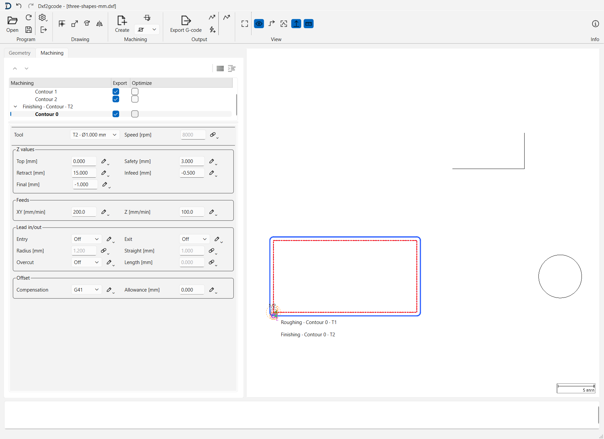

# dxf2gcode

<p align="center">
  
</p>

dxf2gcode is an open-source converter from 2D DXF drawings to G-code for CNC
machines. It provides a Qt interface for preparing drawings and toolpaths,
with configurable postprocessors for output.

**[Downloads](https://github.com/dxf2gcode/dxf2gcode/releases) ·
[Linux Installer](https://github.com/dxf2gcode/dxf2gcode_installer "Installation script for Debian/Ubuntu, Linux Mint and Arch-based systems") ·
[Documentation](https://dxf2gcode.github.io/dxf2gcode/)**

See the documentation for installation, startup and an introduction to the workflow.

**Current Develop prerelease:** [2.0.0.dev14](https://github.com/dxf2gcode/dxf2gcode/releases/tag/develop-ci-45044541606).
It adds the ribbon, integrated VisPy top and spatial views with a 2D fallback,
and expanded holding-tab editing to the machining-project workflow.
[Develop downloads](https://github.com/dxf2gcode/dxf2gcode/releases?q=develop-ci-&include_prereleases=1)
are published after tests and package checks pass. For historical releases, visit the
[SourceForge downloads](https://sourceforge.net/projects/dxf2gcode/files/).
The download archive also contains development builds and release candidates;
check the selected version's description before installing.

## Features

- Import 2D DXF drawings and save or reload `.d2g` projects.
- Inspect original geometry and independent machining operations in linked
  Geometry and Machining views.
- Configure milling, lathe and drag-knife machine modes.
- Prepare contours and pockets, including depth passes and lead moves.
- Organize named machining steps, reuse a contour in several operations and
  undo/redo machining changes.
- Import or draw holding-tab regions and edit their placement and dimensions.
- Export through configurable postprocessor profiles, including G-code output.
- Run command-line exports as well as the graphical application.
- Import PDF and PostScript through the optional external `pdftops` and
  `pstoedit` programs.

See the [technical documentation](source/README.md) for the package structure,
runtime requirements and build details.

## Machining projects

The current workflow separates the original drawing from its machining preparation:

- **Geometry** keeps the original Entities and Layers structure for selection.
  Moving or copying a machining assignment does not move the original contour
  between DXF layers.
- **Machining** contains named steps, each with one machining kind and one tool.
  A contour can belong to several operations, for example roughing and finishing,
  with independent depths, feeds, leads and start points. Export activation and
  order belong to this view.
- **Editing and tools:** move/copy assignments, reuse compatible steps, edit
  several selected operations and undo/redo changes. Provenance symbols distinguish
  own values from inherited step defaults. Saved project tools are compared with
  the current tool table; used deviations must be resolved before export.
- **Holding tabs:** imported `BREAKS:` geometry and manually drawn regions are
  linked to the operations they affect. Direct 2D editing supports moving,
  resizing and entering dimensions, with optional contour alignment and automatic
  sizing from tool diameter plus the configured remaining tab length.
- **Unassigned contours:** original geometry without an operation has no toolpath
  or export. `IGNORE:` contours initially enter this state and can later receive
  ordinary machining assignments, unless excluded entirely during import.
- **Saved preparation:** new projects use **D2G 2.1**, including native tab regions
  and their assignments. D2G 2.0 and legacy 1.1–1.5 projects remain readable;
  older application versions cannot read the new format.



Read [Machining steps](https://dxf2gcode.github.io/dxf2gcode/user-guide/machining-steps/),
[Holding tabs](https://dxf2gcode.github.io/dxf2gcode/user-guide/tabs-and-breaking-layers/)
and [Projects](https://dxf2gcode.github.io/dxf2gcode/user-guide/import-and-projects/)
for the detailed workflow. Compact parameter groups and configurable number
display keep the interface readable without reducing stored or input precision.

## Installation and startup

### Published releases

Choose a [stable GitHub release](https://github.com/dxf2gcode/dxf2gcode/releases/latest)
when available, or a clearly marked
[Develop preview](https://github.com/dxf2gcode/dxf2gcode/releases?q=develop-ci-&include_prereleases=1).
The next stable target is **2.0.0**; a Develop package such as `2.0.0.dev123`
is a preview. Downloads include a Python wheel, source archive, Windows x64
portable ZIP and MSI. Windows packages initially use Python 3.11 / PyQt5 and
are **unsigned**. Verify files against the supplied `SHA256SUMS`.

Extract the entire Windows ZIP before starting `dxf2gcode.exe`, or install
the MSI for the current user. Develop and stable MSI installations use separate
directories. For Python, install the downloaded wheel with `python -m pip install
<wheel-file>` in a virtual environment. When replacing an old date-versioned
installation, use a fresh environment or explicitly install the chosen wheel:
the old date version sorts above `2.0.0`.

[Historical SourceForge downloads](https://sourceforge.net/projects/dxf2gcode/files/)
can have different requirements. See the [release pipeline](doc/release-pipeline.md)
for version mapping, verification and retention rules.

### Linux installer

For Debian- and Arch-based distributions, including Ubuntu and Linux Mint,
the [Linux Installer](https://github.com/dxf2gcode/dxf2gcode_installer "Installation script for Debian/Ubuntu, Linux Mint and Arch-based systems")
provides a script-based installation path. Follow the installer repository's
README for instructions, supported versions and the current development status.

### Run the development checkout

The package declares Python 3.9 or newer; the test documentation identifies
Python 3.11 as a tested version. The commands below use PyQt5 explicitly.
PyQt6 is also supported; see [source/README.md](source/README.md) for its
additional resource-generation requirements. PySide6 is not a supported
runtime binding at present.

Clone the repository and enter it:

```sh
git clone --branch develop --single-branch --no-tags https://github.com/dxf2gcode/dxf2gcode.git
cd dxf2gcode
python -m venv .venv
```

Activate the environment and select PyQt5. On a POSIX shell:

```sh
. .venv/bin/activate
export DXF2GCODE_QT=5
```

On Windows PowerShell instead:

```powershell
.\.venv\Scripts\Activate.ps1
$env:DXF2GCODE_QT = "5"
```

Install the runtime dependencies. Qt Linguist's `lrelease` tool must also be
installed and available on `PATH` for translation compilation; see the
[build documentation](source/README.md).

```sh
python -m pip install "PyQt5>=5.15" "configobj>=5.0.6"
python source/tools/build/qt_assets.py
python source/tools/build/translations.py --no-pylupdate
python source/dxf2gcode.py
```

These commands generate Qt modules and compiled translations locally without
updating the maintained translation catalogs. They do not build a release.
PDF/PostScript import additionally requires `pdftops` and `pstoedit`.

### Refresh the documentation screenshots

With PyQt6, ConfigObj and the generated Qt6 UI modules, run the capture script
from the repository root. It opens the bundled examples in a temporary
profile and saves images from the application.

```sh
python tools/documentation/capture_screenshots.py
```

Use `--spatial` to also refresh the VisPy image of `1997.d2g` on a desktop
with VisPy and working OpenGL. Use `--output <directory>` to review the
captures before replacing the documentation images.

## Help and development tasks

- **User questions and discussions:** use the existing
  [forum on ltspiceusers.ch](https://www.ltspiceusers.ch/forums/english-section.67/).
- **Bugs and development proposals:** use
  [GitHub Issues](https://github.com/dxf2gcode/dxf2gcode/issues).
  Include the version or commit and enough detail to reproduce a problem.
- **Earlier releases:** remain available through
  [SourceForge](https://sourceforge.net/projects/dxf2gcode/files/).

## Development and contributions

Pull requests should target `develop`. Keep changes small and explain their
purpose and validation, especially while the application is being restructured.
See [CONTRIBUTING.md](CONTRIBUTING.md) before starting a contribution.

After preparing the checkout as above, run the focused regression checks from
the repository root:

```sh
python tests/run_tests.py fast
```

See the [test guide](tests/README.md),
[technical documentation](source/README.md) and
[architecture documentation](doc/architecture.md) for further details.

## License

dxf2gcode is distributed under the GNU General Public License, version 3 or
(at your option) any later version (`GPL-3.0-or-later`). See [LICENSE](LICENSE)
for the full text. The original package copy remains in
[source/COPYING](source/COPYING).
