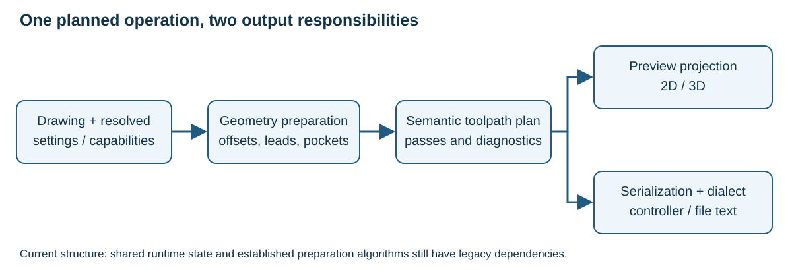

# Architecture

The code is organized around drawing/project state, application workflows,
toolpath planning, adapters and Qt presentation. The directory layout expresses
those responsibilities; legacy dependencies remain and must be checked before
assuming that every module is isolated.

| Package under `source/dxf2gcode/` | Responsibility |
| --- | --- |
| `bootstrap` | Launcher, composition, runtime/version state |
| `domain/geometry` | Points, lines, arcs and geometry calculations |
| `domain/project` | Shapes, layers, machining state and tool settings |
| `domain/toolpath` | Planning inputs, strategies, semantic movements and diagnostics |
| `application` | Import, project, export, shape actions and optimization workflows |
| `adapters` | DXF/config/project storage, planning snapshots, serialization and dialects |
| `presentation/qt` | MainWindow, tree controllers, 2D/3D views, widgets and Qt resources |

## From geometry to output

Imported geometry describes the drawing. A prepared path includes offsets,
leads and clearing geometry. The semantic toolpath plan adds operation order,
depth passes, feeds, tabs, compensation transitions and retracts. A projection
draws it; serialization emits actions through the selected dialect.

The planner is not the tree-order optimizer, and a route-display redraw is not
a request to rebuild/export G-code. A tree reorder must synchronize export
state even when live route drawing is disabled.

## Boundaries that matter during changes

- **Input snapshots:** resolve effective tools, application settings, geometry
  and postprocessor capabilities before planning. A plan should not silently
  retain values from before the latest edit.
- **Geometry:** preserve continuity, order and direction when imported compound
  entities expand into segments. Reverse a complete chain consistently.
- **Planning:** own pass repetition, open-contour reversals, ramps, knife
  orientation and diagnostic outcomes; do not encode these only as canvas effects.
- **Projection:** retain original geometry for selection and show planned
  overlays separately. 2D can coalesce coincident paths; 3D retains depth.
- **Serialization:** format semantic actions and maintain dialect/modal state.
  A controller template must not determine geometry by parsing its own strings.

Milling/lathe/knife mode, G40/G41/G42 side, machine/software compensation and
postprocessor capabilities are separate inputs. A software-compensated side
choice can legitimately serialize a geometric centre path in G40.

## Import boundaries and compatibility limits

All modules under `domain` and `application` are imported in fresh processes
without Qt, presentation, shared runtime globals or concrete adapters. The
boundary regression also constructs shapes/layers with explicit configuration
and applies a project document. Shape and layer constructors require `config`;
optional translation callbacks belong to their callers. Inherited settings
continue to read the current supplied configuration.

The project model receives decoded documents or an injected decoder and
lifecycle callbacks. `presentation/qt/project_session.py` coordinates tree,
canvas, cursor and reload operations. CLI export uses `DrawingSession`, without
GUI placeholders; `bootstrap/composition.py` supplies readers, preparation and
the project codec. Qt runtime version information lives in presentation.
Outer GUI/adapter paths still use `bootstrap/runtime_state.py`; the import
boundary does not imply removal of all shared application state.

The old internal import namespaces were removed rather than kept as public
aliases. File-format compatibility is a separate contract: the current readers
support legacy D2G 1.1–1.5 and JSON D2G 2.0, application configurations 9.11–9.19 and postprocessors
8–8.3. Do not infer arbitrary future-version support from those ranges.

R3/R1b P1–P3 add `domain/project/machining_project.py` and the pure application
bridge `application/machining.py`. Operations reference original geometry and
resolve saved project/step/own values; tools use definition IDs independent of
their output numbers. Detached shape/layer projections feed preview and export.
The version 2.0 codec validates JSON and retains old readers. A temporary Qt
editor bridge applies deltas to the active operation until the machining tab
and move/copy/undo commands are implemented. These later UI stages are pending.

## Review behaviour end to end

Trace a change through imported model, current selection/settings, plan,
preview, saved project and emitted output as applicable. Existing golden files
capture particular serialization contracts; they are not physical-machine
acceptance. Loaded contradictory machining settings remain visible and block
the affected plan rather than being silently repaired. Pocket milling is
supported only in milling mode with software compensation; lathe, drag knife
and machine-compensated pockets retain their settings but have no valid plan.
Any enabled shape with a blocking planning error rejects the entire export
before output: existing target files are preserved and stdout stays empty.
Warnings alone may accompany a valid plan.

For implementation detail see the repository's
[architecture contracts](https://github.com/dxf2gcode/dxf2gcode/blob/develop/doc/architecture.md),
current `domain/toolpath`, `adapters/toolpath` and their focused regressions.
The English overview reflects the current readers rather than the historical
format ranges in older architecture notes.
