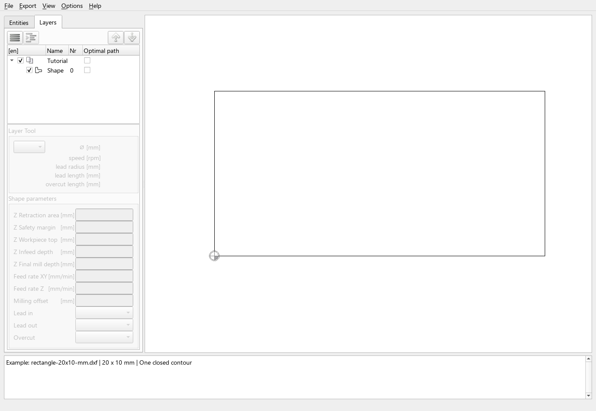
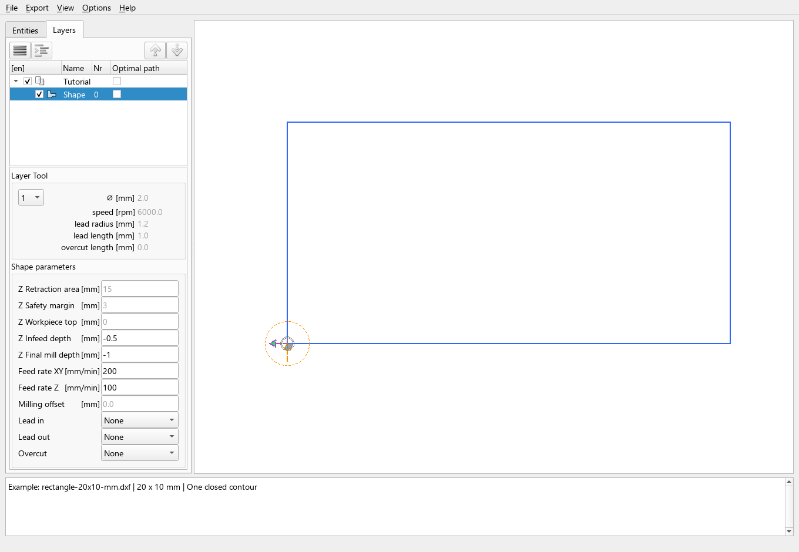

# First DXF to G-code

This walkthrough takes one small drawing from import to an exported `.ngc`
file. You will select a contour, set its machining parameters, inspect the
toolpath and choose an output profile.

Install and start the application using [Installation and startup](../installation.md)
before following these steps. The screenshots use the current development
interface with English labels; translated interfaces have the same controls.

## Example and assumptions

Download [rectangle-20x10-mm.dxf](../assets/examples/first-dxf/rectangle-20x10-mm.dxf)
and save it locally. If your browser displays its contents, use **Save link as**
to keep the `.dxf` extension.

The drawing contains **one closed rectangle**, 20 mm wide and 10 mm high,
on the `Tutorial` layer. Its lower-left corner is at workpiece coordinates
**X = 0, Y = 0**. Units are recorded as millimetres in the DXF.

This is a **file-export demonstration**, not a machining recipe. It uses
milling mode, **G40 No Compensation**, and the built-in
`postpro_config.cfg` profile displayed as **G-CODE for LinuxCNC**. The values
below illustrate the controls and depth passes; they are not selected for a
particular material, cutter or machine. Review the output and controller
requirements before using any generated program on equipment.

With G40, the **tool centre follows the rectangle**. The drawing dimensions
therefore describe the programmed centre path, not a guaranteed finished-part
size after accounting for the cutter radius.

## 1. Start a separate demonstration profile

1. Choose **Options → Configuration profile → New profile...**.
2. Enter `wp1-demo` and confirm. A new profile starts with application defaults;
   it is not a copy of your current machine configuration.
3. Close and restart DXF2GCODE after the profile-selection message.
4. Confirm that **Options → Configuration profile** marks `wp1-demo` as active.
5. Choose **Options → Machine Type → Milling**.

If `wp1-demo` already exists, select it rather than creating it again, then
restart if prompted. For a source checkout, the equivalent explicit startup is:

```sh
python source/dxf2gcode.py --cfg wp1-demo
```

The application configuration profile (`wp1-demo`) and the export postprocessor
(`postpro_config.cfg`) are different things: the first stores your setup; the
second controls the generated output dialect.

## 2. Open and inspect the drawing

1. Choose **File → Open...** and open `rectangle-20x10-mm.dxf`.
2. Confirm that the dimension fields use **mm**, not inches. If necessary,
   select millimetres through **Options → Measurement units → Millimeters**.
3. Select the **Layers** tab and expand `Tutorial` with its triangle or the
   expand button. You should see one child, `Shape 0`.
4. Check that both the layer and shape checkboxes are enabled.



**Expected result:** one rectangle is visible, with the workpiece-origin marker
at its lower-left corner. Before selecting a contour, its parameter fields may
be empty or disabled, as in the screenshot. This does not mean the contour is
excluded from export.

Do not scale, mirror, rotate or move this example. Its coordinates already
match the demonstration. The workpiece origin shown here is a drawing/program
reference; opening the drawing does not set a physical machine work offset.

## 3. Select the contour and set G40

1. Click **Shape 0** in the Layers tree. Its row becomes highlighted and its
   machining fields become available.
2. Right-click the selected rectangle and choose
   **Cutter Compensation → G40 No Compensation**.
3. In that context menu, leave **Pocket Mill** and **Drill Bore** off.
4. Leave **Optimal path** unchecked for this example.

**Selection and enablement are separate:** a highlighted row identifies what
you are editing. The checkbox determines whether that shape is exported.
An enabled shape can be exported even when it is not selected.

## 4. Enter the demonstration values

In the **Layer Tool** area, choose tool **1**. Tool diameter and spindle speed
come from its tool-table entry. If needed, open **Options → Configuration**,
select **Tools**, set tool 1 to **2 mm** diameter and **6000 rpm**, and apply the
changes. Return to the drawing and select `Shape 0` again.

Enter the following in **Shape parameters**, confirming each edited field
with **Enter** or by leaving the field:

| Field | Value | Meaning in this example |
| --- | --- | --- |
| Z Retraction area | `15` mm | Retraction level used between operations |
| Z Safety margin | `3` mm | Approach/retract distance above the workpiece top |
| Z Workpiece top | `0` mm | Top surface is the Z reference |
| Z Infeed depth | `-0.5` mm | Depth increment for each pass |
| Z Final mill depth | `-1` mm | Final depth below the top surface |
| Feed rate XY | `200` mm/min | Cutting feed in the drawing plane |
| Feed rate Z | `100` mm/min | Vertical feed |
| Milling offset | `0` mm | No extra finishing allowance |
| Lead in | `None` | No additional entry geometry |
| Lead out | `None` | No additional exit geometry |
| Overcut | `None` | No extension past the contour closure |

For this single contour, the depth settings produce **two passes**: first at
Z = -0.5 mm, then at Z = -1 mm. Retraction and safety-margin fields apply to
the layer; the cutting depth and feeds can be set for the selected contour.



## 5. Inspect the preview

Keep the shape selected to see its planned path. The blue G40 centre path
should follow all four rectangle edges and return to the start. No separate
lead-in, lead-out or overcut should appear with the settings above.

The dashed tool-entry circle represents the selected tool's radius at the
entry point. It does not add a circular cutting movement. A 2D view also
overlays repeated XY passes: seeing a single rectangle does **not** mean there
is only one depth pass.

For this one-shape drawing, ordinary tree order is sufficient. **Optimal path**
is an optimization setting, not a second enable checkbox. Route-display arrows
are an aid to inspection, not a replacement for checking the exported program.

## 6. Export without optimization

1. Choose **Export → Export Shapes without Optimization**.
2. In **Export to file**, select **G-CODE for LinuxCNC (*.ngc)** as the output
   type. This selects the demonstration postprocessor.
3. Choose a destination and save as `rectangle-20x10-mm.ngc`.

**Expected result:** a non-empty `.ngc` file is written. The normal export uses
the enabled contours and their tree order; it does not export only the selected
contour. There is just one enabled contour in this example.

If the LinuxCNC output type is missing, check that you are using the fresh
demonstration profile and its default postprocessor. A custom postprocessor
can have another description, extension and command sequence.

## 7. Check the exported file

Open the `.ngc` file in a text editor. The header should identify
`postpro_config.cfg`. With the demonstration profile, the program includes:

- `G21` for millimetres and `G90` for absolute coordinates;
- `G40`, without a `G41` or `G42` compensated contour;
- a closed path covering X = 0…20 mm and Y = 0…10 mm;
- the contour repeated at Z = -0.5 mm and Z = -1 mm.

This excerpt illustrates the first depth pass; spacing may vary:

```gcode
G0 X   0.000 Y   0.000
G0 Z   3.000
F100
G1 Z  -0.500
F200
G1 X   0.000 Y  10.000
G1 X  20.000 Y  10.000
G1 X  20.000 Y   0.000
G1 X   0.000 Y   0.000
```

This is an excerpt, not a standalone program. The default LinuxCNC profile
also emits tool-selection/change, spindle and coolant commands such as
`T1 M6`, `M3` and `M8`, and their stop commands. Inspect the complete output;
the preview does not simulate those controller actions or establish machine
compatibility.

## Drawing, project and program

- The downloaded **DXF** contains the rectangle geometry.
- A **D2G project** saves the preparation settings and drawing reference. It
  is different from exported G-code; keep the referenced DXF with it.
- The exported **NGC file** is the postprocessor output.

If the result differs, first check units, shape enablement, G40, depth values
and the selected postprocessor. For help, use the
[existing forum](https://www.ltspiceusers.ch/forums/english-section.67/).
For a reproducible defect, use the
[issue forms](https://github.com/dxf2gcode/dxf2gcode/issues/new/choose) and attach
a small example and relevant profiles.

Continue with [contours, pockets and drilling](../user-guide/contours-pockets-and-drilling.md),
[compensation and lead moves](../user-guide/compensation-and-leads.md), or
[preview and export](../user-guide/preview-and-export.md). For other workflows,
see [drag-knife cutting](../user-guide/drag-knife-cutting.md) and
[command-line usage](../user-guide/command-line-usage.md). See
[Tool changes and macros](../reference/tool-changes.md) for that configuration.
Return to the
[project overview](../index.md) for the other available chapters.
