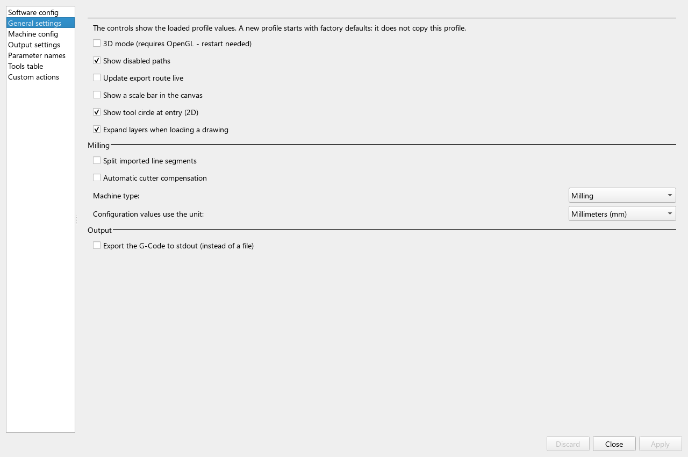

# Application settings

Open **Options → Configuration** to edit the active application profile.
Postprocessor configuration is separate: it defines controller output syntax
and is selected for export. A D2G project saves drawing preparation, not every
application or postprocessor setting.

## Find the right page

| Configuration page | Main purpose |
| --- | --- |
| Software config | Default drawing/output/project folders, path updates, PDF/PS converters and logging |
| General settings | View options, import splitting, automatic compensation, machine mode, units and stdout output |
| Machine config | Axis letters, coordinate/depth defaults and feeds |
| Output settings | Machine/software compensation, pockets, knife options, leads, route optimizer and import settings |
| Parameter names | Recognized names in parameterized DXF layers |
| Tools table | Tool numbers, diameter or knife offset, speed and tool-sourced dimensions |
| Custom actions | Named literal G-code actions available in the tree |



The fields show the loaded profile. A tooltip can explain the field or its
factory default. **Apply** validates and applies edits; **Discard** abandons
pending edits. Close becomes available after pending edits are resolved.

## Configuration profiles

Use **Options → Configuration profile → New profile...** to create a separate
setup, or select an existing one. New profiles start with factory defaults;
they do not clone the active machine configuration. Profile selection requires
restart to take effect. Save your project before switching.

Names use ASCII letters, digits, `-` and `_`, starting with a letter or digit.
Use a suffix such as `knife-demo`, not a path or a name containing spaces.
For explicit source-checkout startup:

```sh
python source/dxf2gcode.py --cfg knife-demo
```

Without a CLI override the last profile selected in the GUI is used, then the
default when none has been selected. Explicit CLI selection does not replace
the saved GUI choice.

## Configuration files

| File | Linux | Windows |
| --- | --- | --- |
| Application | `~/.config/dxf2gcode/config/config.cfg` | `%USERPROFILE%\.config\dxf2gcode\config\config.cfg` |
| Postprocessor | `~/.config/dxf2gcode/postpro_config/<name>.cfg` | `%USERPROFILE%\.config\dxf2gcode\postpro_config\<name>.cfg` |

Named profiles replace `dxf2gcode` with `dxf2gcode.<suffix>`, for example
`dxf2gcode.knife-demo`. These Windows paths are under the user home directory,
not AppData. The startup message **For Configuration files refer to folder:**
links the active runtime folder; use that path when checking an older installation.

For support, attach the actual active profile and selected postprocessor when
relevant. Do not send an unrelated default postprocessor just because its
filename is familiar. Back up files before manual edits or migration.

## Selected factory defaults

These are new-profile defaults in application configuration **9.19**. Existing
profiles and loaded projects can have different values.

| Key/setting | Factory value |
| --- | --- |
| `General.machine_type`, `tool_units` | `milling`, `mm` |
| Show disabled paths / entry tool circle | On / On |
| Live export-route display / split imported lines | Off / Off |
| Automatic cutter compensation | Off |
| `Cutter_Compensation.done_by_machine` | `True` |
| Retraction / safety margin / workpiece top | `15 / 3 / 0 mm` |
| Infeed / final depth | `-1.5 / -3 mm` |
| XY / Z feed | `400 / 150 mm/min` |
| Point / fitting tolerance | `0.001 / 0.001` in the configuration's linear units |
| Import-exclude IGNORE / layer 0 | Off / Off |
| `Layer_Options.id_float_separator` | `:` |

Defaults are initialization values, not material or controller recommendations.
Tool 1 supplies the initial tool values; imported layer identifiers and saved
project/contour settings can override them. See
[Machining parameters](machining-parameters.md) for selection scope and reset rules.

## When settings take effect

| Change | Effect |
| --- | --- |
| Machine type | Refresh current drawing and save the selected mode |
| Measurement units | Convert current values immediately |
| Import tolerances | Fully reload the drawing; save preparation first |
| 2D/3D mode or logging | Notify after Apply; restart after confirmation and closing configuration |
| Configuration-profile selection | Load the selected profile at restart |

Automatic restart begins with an empty window; it does not recover unsaved
contour/tool edits. If the new process cannot be started, the existing window
remains open. If restart-requiring changes are reverted, a restart is no longer
needed for those changes.

## Compatibility and damaged files

The current application reader accepts configuration versions **9.11–9.19**.
Supported old settings can be migrated; legacy knife depth meanings have their
own [migration](drag-knife-cutting.md#older-projects-and-further-reading).
This version number is not the application release number or D2G format version.

An unsupported version is reported rather than safely guessed. Do not change
its version tag alone to force acceptance. Preserve the original file and
check the expected version and installation. For other unreadable/invalid
configurations, recovery can rename `config.cfg` to `config.bad` and create
defaults; an existing `.bad` file can be overwritten. Keep an independent backup
before retrying a known damaged profile. A fresh profile is useful for comparison
without deleting the original setup.

Continue with [Layer naming rules](layer-naming-rules.md).
