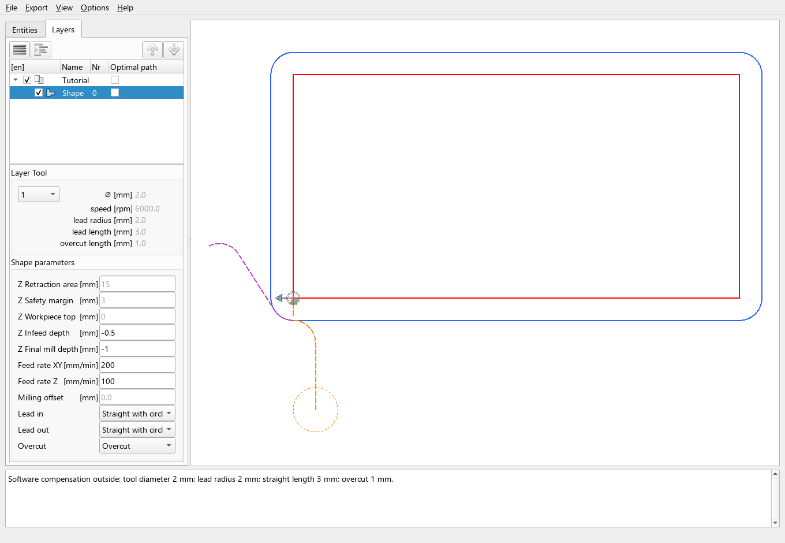

# Cutter compensation and lead moves

In the current development UI, edit compensation and leads in the active
operation's [Machining form](machining-steps.md). Screenshots and
control positions below predate the Geometry/Machining layout; the machining rules still apply.

First decide whether your DXF describes a tool-centre path or a nominal part
boundary. Then choose the compensation side and who calculates the tool-radius
offset. Entry and exit geometry are separate choices.

## G40, G41 and G42

For a selected milling contour, right-click and open **Cutter Compensation**.

| Choice | Meaning relative to the cutting direction |
| --- | --- |
| G40 No Compensation | Follow the contour as a centre path, except for operations such as pocketing that prepare their own paths |
| G41 Left Compensation | Place the cutter centre on the left side |
| G42 Right Compensation | Place the cutter centre on the right side |

Left and right are relative to travel, not fixed screen directions. For a
clockwise closed rectangle, the left side is outside; for an anticlockwise
rectangle, the right side is outside. Recheck the side after **Switch Direction**.

Automatic cutter compensation can choose sides from contour containment in
milling mode. It is an assignment aid, not a substitute for reviewing nested,
overlapping or unusual contours and their order.

## Software versus machine compensation

The output settings in **Options → Configuration** choose whether compensation
is performed by the machine.

| Mode | Geometry/output to expect |
| --- | --- |
| Software compensation | DXF2GCODE calculates the offset centre path; the prepared compensated operation is emitted in G40 |
| Machine compensation | The program uses nominal geometry and G41/G42 commands; the controller calculates the actual tool-centre offset |

In software mode, the selected G41/G42 side still determines the geometric
offset even though the exported operation uses G40. This is expected. In
machine mode, the displayed path/tool circle cannot establish the exact motion
your controller will make. The postprocessor and controller's compensation
rules remain relevant.

**Milling offset** is an additional software-compensation allowance. A positive
value increases the distance from the nominal boundary on the compensated side,
leaving more material. It is not a way to move an ordinary G40 contour, and
machine compensation does not apply this allowance geometrically. If the
allowance cancels the tool radius, a valid compensated path may no longer exist.

## Choose lead-in and lead-out methods

The contour's **Lead in** and **Lead out** selectors control the method.
Dimensions come from the effective tool/layer values: **lead radius** at the
workpiece and **lead length** for the straight portion.

| Method shown in the interface | Lead in | Lead out |
| --- | --- | --- |
| None | No optional entry geometry | No optional exit geometry |
| Straight | Straight approach | Straight departure |
| Straight with circle | Straight portion and a quarter-circle transition | Quarter-circle transition with a straight portion |
| Circle | Merged into Straight with circle for entry | Quarter-circle departure without a straight portion |

“Circle” here means a quarter-circle transition, not a complete circular cut.
The workpiece radius and tool-centre radius are different when compensation is
active. On an inside arc, the tool radius can make the centre-path arc collapse;
review radius warnings rather than assuming any positive radius is usable.
Unused radius/length fields are not requirements for a method that does not
use them.

Machine G41/G42 needs an XY movement to build compensation. **Lead in = None**
is therefore rejected for that case. G40 and software compensation can use
None. For G40's curved entry, historical centre-radius geometry is retained;
do not assume its plunge/straight portion is identical to a compensated entry.

For drag-knife alignment and swivel behaviour, see
[Drag-knife cutting](drag-knife-cutting.md).

## Add an overcut

On a closed contour, **Overcut** continues along the contour past its closure
by the configured **overcut length**. It is different from a lead-out departing
from the contour. With an open-only selection the selector is disabled; in a
mixed selection only closed contours receive the overcut change.

Enabling Overcut with zero length adds no extension. The length is associated
with the effective tool/layer settings, while enablement can be set per contour.
The configuration standard can be restored as described in
[Machining parameters](machining-parameters.md#restore-a-standard-deliberately).

## Inspect a concrete software-compensation example

Use the [WP1 rectangle](../assets/examples/first-dxf/rectangle-20x10-mm.dxf)
in a separate milling profile with software compensation. Set tool diameter
`2 mm`, additional offset `0 mm`, lead radius `2 mm`, straight length `3 mm`
and overcut length `1 mm`. Select outside compensation: G41 when travelling
clockwise, G42 when travelling anticlockwise. Choose **Straight with circle**
for both leads and enable **Overcut**.

The pictured clockwise example uses G41, top `0 mm`, infeed `-0.5 mm`, final
depth `-1 mm`, XY feed `200 mm/min`, Z feed `100 mm/min`, retraction `15 mm`
and safety margin `3 mm`. These are illustrative preview values. The original
rectangle stays 20 × 10 mm; the blue path lies outside it. The 1 mm overcut
overlaps part of an already traversed edge, so it need not appear as a separate
isolated line. Entry and departure are drawn over the centre path for visibility.

Continue with [Preview and export](preview-and-export.md) or
[Toolpath diagnostics](toolpath-diagnostics.md) if a movement is missing.
