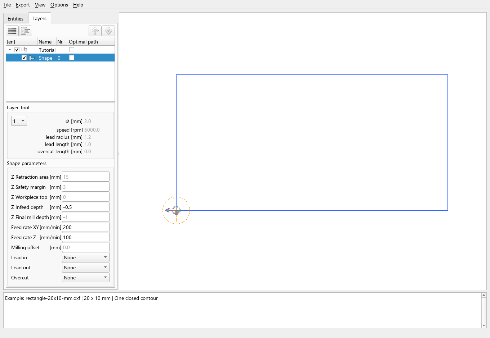

# Interface and navigation

This chapter explains the main window in the current development version.
The screenshot uses English labels and the 2D view. Other interface languages
provide the same controls; 3D navigation is not covered here.

The screenshots below predate the combined **Geometry** tab and separate **Machining** tab. In the current
development version, use [Machining steps](machining-steps.md) for tools,
parameters, export activation, move/copy and undo.

Start with [First DXF to G-code](../getting-started/first-dxf-to-gcode.md)
if you want a complete example, or download its
[20 × 10 mm rectangle](../assets/examples/first-dxf/rectangle-20x10-mm.dxf)
and open it through **File → Open...**.

## Find your way around

| Area | What it is for |
| --- | --- |
| Menu bar | Open drawings and projects, save projects, export programs, change the view and configure the application |
| Geometry tab, upper left | Select original geometry in the collapsible Entities and Layers sections |
| Machining tab | Name and order steps, select tools/kinds, move/copy assignments and control export |
| Tool and contour fields in Machining | Edit step defaults or the active operation; chain/pencil symbols show inheritance |
| Drawing view, right | Inspect geometry, select contours and display toolpath aids |
| Message pane, bottom | Read import information, warnings and operation results |

The **Entities** tab follows the imported entity/block structure. The
**Layers** tab groups contours by layer and is the useful starting point for
selecting an entire source layer. Both show the same drawing rather
than separate copies. Expand a row to see its children.

The rectangle example contains one layer, `Tutorial`, and one contour,
`Shape 0`. A CAD object does not always become exactly one shape: connected
segments can be joined, and compound entities can produce several pieces.

## Select a contour or include it in export

Click a shape row in the tree or click near a contour in the drawing view.
The selected contour is highlighted along with its linked machining entries.
Click the desired entry in **Machining** to edit it. With multiple references,
selecting original geometry does not choose an editing context automatically.

**Selection and enablement serve different purposes:**

- A selected shape is the shape you are inspecting or editing.
- An enabled operation is included in export. Use its **Export** checkbox in
  **Machining**; Entities and Layers have no export checkboxes.
- A disabled shape is excluded even if you select it. An enabled shape can
  be exported without being selected.

In the 2D drawing view, **Ctrl + click** lets you toggle additional contours
in the selection. Dragging a selection rectangle also selects contours.
For an individual parameter change, select just the intended contour first.

Do not infer export order from the order in which you click contours. See
[tree order](shapes-layers-and-order.md) and [route optimization](route-optimization.md)
for the separate order, display and optimization controls.

## Move around the 2D view

| Action | Control |
| --- | --- |
| Zoom in or out | Mouse wheel over the drawing |
| Pan | Hold **Shift** and drag with the left mouse button |
| Fit the drawing into the view | **View → Autoscale** |
| Open contour and position commands | Right-click in the drawing view |

Zooming, panning and Autoscale change the view. They do not scale the drawing
or change its workpiece coordinates. Drawing transformations such as moving
the workpiece origin are separate operations.

The tree's expand/collapse buttons reveal or hide child rows without changing
their enablement. With focus in either tree, **Ctrl + Shift + Right** expands
that entire active tree; **Ctrl + Shift + Left** collapses it.

## Read the preview and parameters together

The screenshot shows the rectangle in **G40 No Compensation**. Its tool-centre
path follows the drawing, and the tool-entry circle represents the tool
radius. It does not add a circular move. Leads, compensation and other modes
can produce additional geometry, so the outline alone is not the complete
description of the machining operation.

A 2D view overlays passes with the same XY coordinates. Check the depth
fields to understand the number of passes. The example's `-0.5 mm` infeed
and `-1 mm` final depth produce two passes even though one rectangle is visible.

Check the units displayed beside the fields before editing values. Retraction
and safety margin belong to the layer, whereas cutting depths and feeds can
be stored per contour. Tool-table defaults, layer settings and contour
overrides are not interchangeable.

## Use the message pane when something looks wrong

After import, read the messages for geometry counts, units and warnings.
Unsupported entities or excluded layers can explain missing geometry. If a
contour is not exported, check its enable checkbox and any reported machining
conflict before changing the drawing.

Preview aids help inspect the preparation; they do not simulate all controller
commands. For a complete file-export example, return to
[First DXF to G-code](../getting-started/first-dxf-to-gcode.md).
Continue with [Import drawings and save projects](import-and-projects.md)
to preserve your work and understand what happens when files are reopened.
