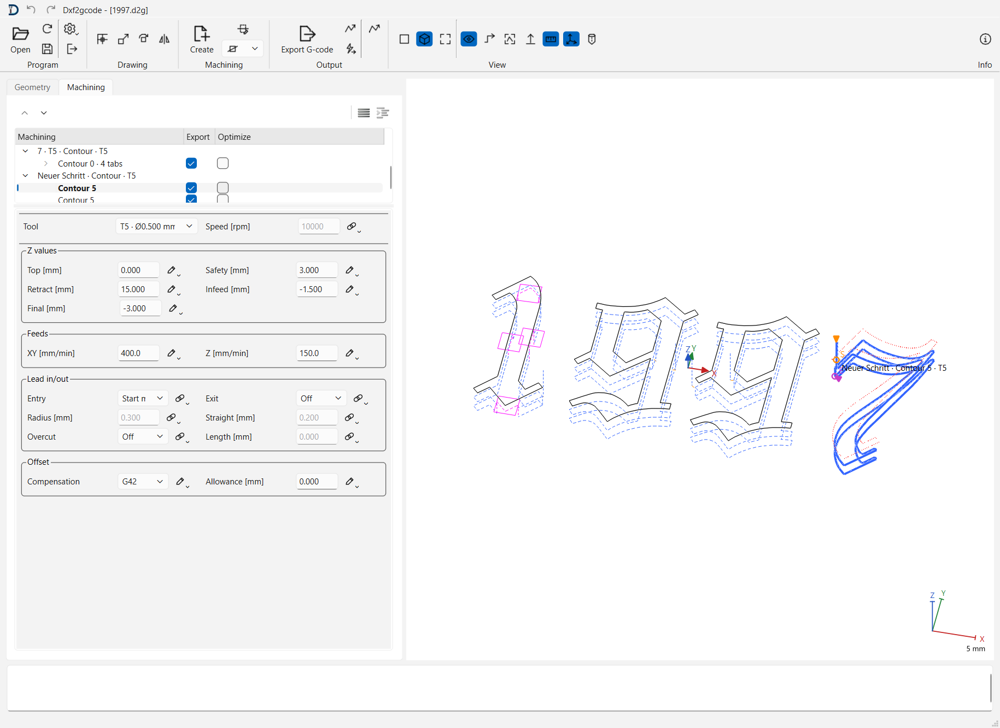
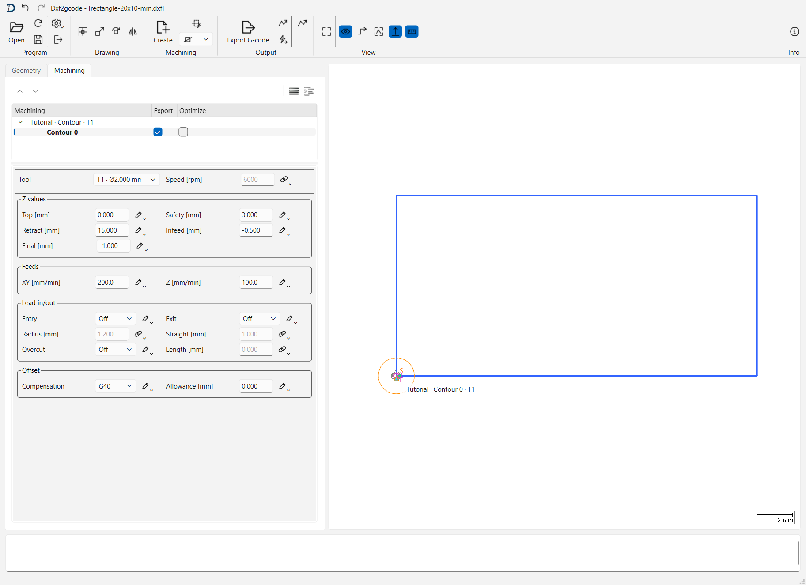

# Interface and navigation

This chapter explains the main window in the current development version.
The screenshots use English labels.

The **Geometry** tab contains collapsible Entities and Layers sections.
The **Machining** tab owns tools, parameters, export activation and order.
See [Machining steps](machining-steps.md) for assignment, copying and undo.

Start with [First DXF to G-code](../getting-started/first-dxf-to-gcode.md)
if you want a complete example, or download its
[20 × 10 mm rectangle](../assets/examples/first-dxf/rectangle-20x10-mm.dxf)
and open it through **Program → Open DXF or project...**.

## Find your way around

| Area | What it is for |
| --- | --- |
| Title bar | Shows the document title. On Windows with Qt 6.9 or newer, it also hosts machining Undo and Redo |
| Ribbon | Open and save projects, transform the drawing, control the view, edit machining, export and open settings |
| Geometry tab, upper left | Select original geometry in the collapsible Entities and Layers sections |
| Machining tab | Name and order steps, select tools/kinds, move/copy assignments and control export |
| Tool and contour fields in Machining | Edit step defaults or the active operation; chain/pencil symbols show inheritance |
| Drawing view, right | Inspect geometry, select contours and display toolpath aids |
| Message pane, bottom | Read import information, warnings and operation results |

Drag the horizontal divider immediately above the message pane up or down
to change its height. The drawing and sidebar share the remaining space;
resizing preserves the messages and project values.

The **Entities** section follows the imported entity/block structure. The
**Layers** section groups contours by layer and is the useful starting point for
selecting an entire source layer. Both show the same drawing rather
than separate copies. Expand a row to see its children.

The rectangle example contains one layer, `Tutorial`, and one contour,
`Shape 0`. A CAD object does not always become exactly one shape: connected
segments can be joined, and compound entities can produce several pieces.

## Select a contour or include it in export

Click a shape row in the tree or click near a contour in the drawing view.
The selected contour is highlighted along with its linked machining entries.
Click the desired entry in **Machining** to edit it. With multiple references,
selecting original geometry does not choose an editing context automatically.

**Selection and enablement serve different purposes:**

- A selected shape is the shape you are inspecting or editing.
- An enabled operation is included in export. Use its **Export** checkbox in
  **Machining**; Entities and Layers have no export checkboxes.
- Clicking **Export** or **Optimize** changes the checkbox while keeping the
  current selection. Right-click a column or its heading to enable or disable
  all checkboxes in that column. Undo takes back the whole change in one step.
- A disabled operation is excluded even if selected. Original geometry without
  any machining assignment has no export; enabled operations can export without
  being selected.

In the 2D canvas and VisPy top view, **Ctrl + click** lets you toggle additional contours
in the selection. Dragging a selection rectangle also selects contours.
For an individual parameter change, select just the intended contour first.

Do not infer export order from the order in which you click contours. See
[tree order](shapes-layers-and-order.md) and [route optimization](route-optimization.md)
for the separate order, display and optimization controls.

## Navigate the drawing

When available, VisPy starts in **Spatial view**. Drag with the left mouse button
to rotate and use the wheel to zoom. **Top view** animates to the fixed editing
view. Both views show the same XYZ toolpaths. In the top view, drag to select
original contours, use **Ctrl** to toggle them, or use **Shift** and drag to pan.
Right-click opens the contour commands in both views. Use the top view to set
the workpiece zero or contour start point at the clicked location, or to draw
a holding-tab region. Dragging with the right mouse button zooms in the
spatial view.
Activating holding-tab editing switches VisPy to the top view.

Ribbon group names appear below their buttons. **Open**, **Create…** and
**Export G-code** have larger icons and visible labels. Their related controls
are arranged alongside them in two rows. Hover over a button or focus it with
the Tab key to see its tooltip. The active camera and enabled switches are
highlighted.

**Program** opens and reloads drawings or projects, saves the project under a
chosen name and exits the application. **Drawing** contains workpiece zero,
scale, rotate and mirror. **Output** contains **Show export order**,
standalone path optimization and G-code export with or without optimization.

**View** contains the fit button and the disabled-path and path-direction
switches. **Toolpaths for selected contours only** keeps the original drawing
visible and limits machining lines and holding-tab regions to the selection,
including in tab edit mode. **Show Z retracts** controls
upward rapid moves in the toolpath preview. VisPy also provides the top and
spatial views and transparent tool bodies. In spatial view, positive XYZ axes
mark workpiece zero in red, green and blue. Use **Show XYZ axes at workpiece
zero** in **View** to toggle the symbol. Top view uses the circular zero
marker. The ruler icon in **View** toggles the zoom-dependent scale bar in
either renderer. In spatial view the scale shows equal world lengths along
X, Y and Z, projected with the current camera. The scale stays in the
lower-right corner. Existing profiles keep their scale-bar preference.

Window position and size, pane sizes and the View switches are restored the
next time the application opens. On Windows, Qt saves them under
`HKEY_CURRENT_USER\Software\dxf2gcode\dxf2gcode\MainWindow`.

Under **Program**, the gear opens **Options**, including the profile
selector, application and postprocessor settings, and the machine type and
measurement units submenus. **Info**, at the right edge of the ribbon, opens
**About DXF2GCODE** directly.

**Machining** contains the button to create a step and the holding-tab edit
toggle. The placement selector appears while tab editing is active.
On Windows with expanded title-bar support, Undo and Redo sit between the
application icon and the document title. On other setups, they appear in the
ribbon's **History** group.

In VisPy, **View** also offers **Transparent tools**. It shows a schematic
cylinder at the start of each selected enabled operation using its planned
diameter. The cylinder length is four diameters.

To start with the 2D canvas, turn off **3D view with VisPy** in the application
configuration and restart. The 2D canvas also opens automatically when VisPy or
working OpenGL is unavailable. The message pane reports why.

The application starts with the **Machining** tab selected. Switch to
**Geometry** whenever you need the original entity or layer selection.

| Action | Control |
| --- | --- |
| Zoom in or out | Mouse wheel over the drawing |
| Pan | Hold **Shift** and drag with the left mouse button |
| Fit the drawing into the view | Frame icon under **View** |
| Open contour and position commands | Right-click in the drawing view |

Zooming, panning and Autoscale change the view. They do not scale the drawing
or change its workpiece coordinates. Drawing transformations such as moving
the workpiece origin are separate operations.

The tree's expand/collapse buttons reveal or hide child rows without changing
their enablement. With focus in either tree, **Ctrl + Shift + Right** expands
that entire active tree; **Ctrl + Shift + Left** collapses it.

Resizing the main window keeps the left pane width and message-pane height;
the canvas receives the extra space. Within Machining, the tree receives extra
height while the parameter pane retains its height. Drag the splitters manually
to choose another distribution. Pane sizes and collapsed geometry
sections are remembered across restarts. The minimum window size protects the
canvas from being squeezed away.

## Read the preview and parameters together

The screenshot shows the rectangle in **G40 No Compensation**. Its tool-centre
path follows the drawing, and the tool-entry circle represents the tool
radius. It does not add a circular move. Leads, compensation and other modes
can produce additional geometry, so the outline alone is not the complete
description of the machining operation.

A 2D view overlays passes with the same XY coordinates. Check the depth
fields to understand the number of passes. The example's `-0.5 mm` infeed
and `-1 mm` final depth produce two passes even though one rectangle is visible.

Check the units displayed beside the fields before editing values. Retraction
and safety margin belong to the machining step, whereas cutting depths and
feeds can be stored per operation. Tool-table definitions, saved step defaults
and own operation values have separate scopes.

## Use the message pane when something looks wrong

After import, read the messages for geometry counts, units and warnings.
Unsupported entities or excluded layers can explain missing geometry. If a
contour is not exported, check its enable checkbox and any reported machining
conflict before changing the drawing.

Preview aids help inspect the preparation; they do not simulate all controller
commands. For a complete file-export example, return to
[First DXF to G-code](../getting-started/first-dxf-to-gcode.md).
Continue with [Import drawings and save projects](import-and-projects.md)
to preserve your work and understand what happens when files are reopened.
