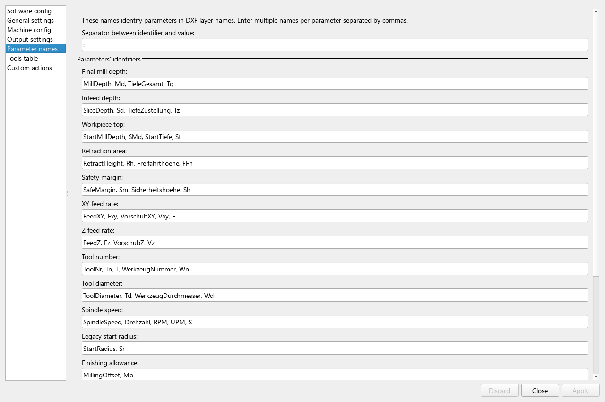

# Layer naming rules

Special DXF layer names can initialize machining values during import. Configure
recognized aliases through **Options → Configuration → Parameter names**.
Multiple aliases in a configuration field are separated by **commas**. This
list separator is different from the identifier/value separator used inside
a DXF layer name.



## Prefix, identifier and value

With the default separator `:`, use uppercase prefixes:

| Prefix | Meaning |
| --- | --- |
| `MILL:` | Parameterized machining layer |
| `DRILL:` | Parameterized drilling layer; use compatible closed arc geometry |
| `BREAKS:` | Tab/break instruction regions |
| `IGNORE:` | Imported shapes initially disabled, unless excluded from import |

Prefix and alias matching are case-sensitive. A plain layer called `Tutorial`
imports normally but does not parse embedded parameter instructions as a MILL,
DRILL or BREAKS layer. Changing the configured separator changes the recognized
prefixes as well as the parameter pairs.

The parser recognizes configured letter identifiers and numeric values. Use
simple signed decimal numbers, with a point; it does not evaluate expressions,
unit suffixes or scientific notation. Values are in the active setup's units.
Layer names do not establish the drawing's units on their own.

## Useful default identifiers

| Parameter | Default aliases shown here |
| --- | --- |
| Final depth | `MillDepth`, `Md` |
| Infeed | `SliceDepth`, `Sd` |
| Workpiece top | `StartMillDepth`, `SMd` |
| Retraction / safety margin | `RetractHeight`, `Rh` / `SafeMargin`, `Sm` |
| XY / Z feed | `FeedXY`, `Fxy`, `F` / `FeedZ`, `Fz` |
| Tool number / diameter | `ToolNr`, `Tn`, `T` / `ToolDiameter`, `Td` |
| Spindle speed | `SpindleSpeed`, `RPM`, `S` |
| Additional software offset | `MillingOffset`, `Mo` |
| Lead-in / lead-out mode | `LeadInMode`, `Lim` / `LeadOutMode`, `Lom` |
| Workpiece lead radius / straight length | `LeadRadius`, `Lr` / `LeadLength`, `Ll` |
| Overcut length | `OvercutLength`, `Ol` |

The configuration page also contains German aliases. Add aliases there when
needed rather than assuming a translated interface changes the DXF syntax.
Avoid ambiguous/repeated identifiers in a layer name.

## Worked layer names

```text
MILL: Tn:1 SMd:0 Sd:-0.5 Md:-1.5 FeedXY:200 FeedZ:100
```

With tool 1 present and mm selected, this initializes top Z = 0, infeed
-0.5 mm, final depth -1.5 mm and feeds 200/100 mm/min. Its three depth passes
are -0.5, -1 and -1.5 mm. It does not select G41/G42 or make a material-specific
tool choice for you. This name is included in the
[own tab example](../assets/examples/tabs/rectangle-with-tab-mm.dxf).

```text
MILL: Tn:1 Td:2 Lr:2 Ll:3 Lim:2 Lom:1 Ol:1
```

This sets tool 1, diameter 2, workpiece lead radius 2, straight length 3,
straight lead-in, straight lead-out and overcut length 1 in the active units.
**Ol does not enable overcut**; enablement is a separate contour/configuration
choice. The dimensions are illustrative.

## Numeric lead modes

The entry and exit numbering differ:

| Value | `Lim` (lead-in) | `Lom` (lead-out) |
| --- | --- | --- |
| 0 | Straight with circle | None |
| 1 | None | Straight |
| 2 | Straight | Circle |
| 3 | Circle; displayed as the combined entry method | Straight with circle |
| 4 | Use configuration default | Use configuration default |

Prefer the normal contour selectors for interactive changes. See
[lead geometry](compensation-and-leads.md) for dimensional meaning and limits.
The legacy `StartRadius`/`Sr` means a historical tool-centre radius and is
converted by adding tool radius to obtain the workpiece lead radius. Use
`LeadRadius` for new examples.

## Precedence and reloading

Configuration and tool 1 provide starting values. Parameter pairs are processed
in the order they appear in the layer name. A tool-number pair loads that tool's
values; later explicit pairs can replace them. Put `Tn` before dimensions and
allowances when you want those explicit values to win. A nonexistent tool
number is reported and falls back to tool 1.

After import, contour tool/mode overrides and saved D2G preparation can replace
the starting values. Reopening a DXF reapplies its layer rules; it is not the
same as reopening the saved project. Layer lead overrides can remain distinct
from global defaults, so do not infer precedence only from a grey field.

## IGNORE is not always an import filter

With default settings, `IGNORE:` shapes are imported and initially disabled.
They can still be inspected when disabled paths are shown. Enabling **Do not
import IGNORE layers** removes them during import instead. The independent
layer-0 exclusion can also remove drawing/block content. Recheck the import
counts and geometry after changing either filter.

Continue with [Application settings](application-settings.md) or
[Troubleshooting](troubleshooting.md).
