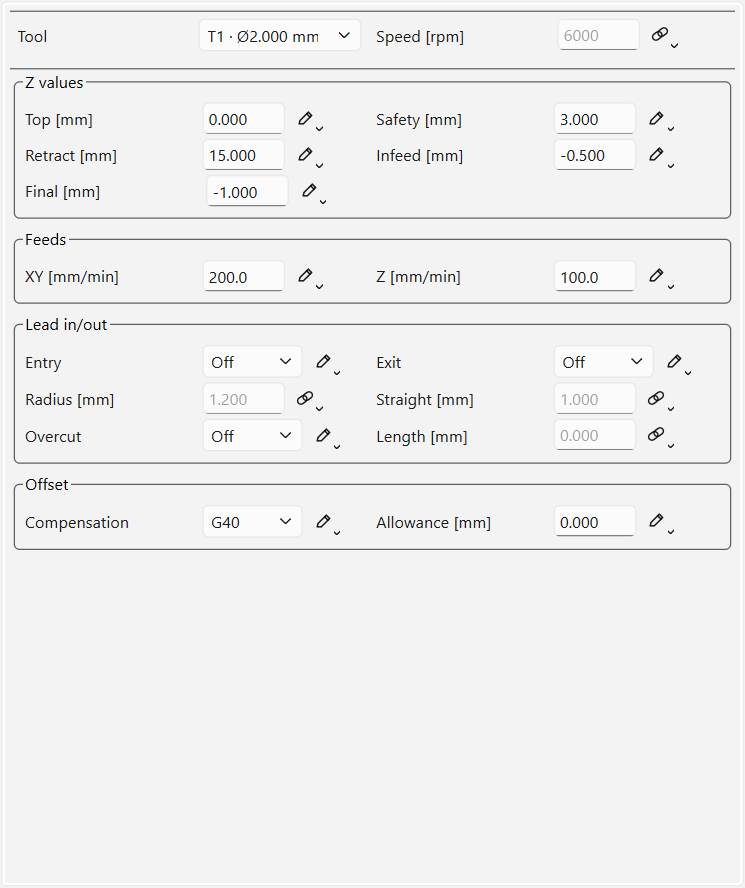

# Machining parameters

Select a step or contour assignment in **Machining** before editing values.
Selecting a step edits its defaults; selecting operations edits their own
values or their inheritance from the step. **Geometry** selects original
contours and layers, whose drawing structure remains unchanged.

## Units and depths

Check the units beside each field. Lengths use mm or inches, feeds use length
per minute, and spindle speed uses rpm. Changing drawing units converts the
current values. Typing `1` means one unit in the displayed system.

| Group / field | Meaning and scope |
| --- | --- |
| Z values / Top | Workpiece surface Z; can have an operation override |
| Z values / Safety | Approach distance above workpiece top; always a step value |
| Z values / Retract | Retraction Z coordinate; always a step value |
| Z values / Infeed | Depth increment for successive cuts |
| Z values / Final | Final Z coordinate, not a positive stock thickness |
| Feeds / XY and Z | Planar cutting and axial feeds |
| Offset / Compensation and Allowance | G40/G41/G42 and additional software finishing allowance |
| Lead in/out | Entry, exit, radius, straight length and overcut settings for the operation |

For example, top `0`, infeed `-0.5` and final `-1.2 mm` produce cuts at
**-0.5, -1.0 and -1.2 mm**. With top `2 mm`, final `1 mm` means cutting
1 mm below that top, not down to Z = -1 mm. Use a nonzero infeed and read
depth diagnostics before exporting. Open contours can reverse on successive
milling passes; a depth table does not describe all controller actions.

## Tools, defaults and contour values

Define tools under **Options → Configuration → Tools table**. Each machining
step has exactly one tool definition. The selector combines the table and
saved project tools, showing identical complete definitions only once.
An unmatched saved definition is marked **Project deviation**.

| Selection/action | Scope |
| --- | --- |
| Change the tool with a step selected | Change that step's tool |
| Change the tool with contour assignments selected | Change only those assignments; reuse a compatible step or create one, retaining the source defaults and own values |
| Several compatible destination steps exist | Choose the destination; cancellation changes nothing |
| Edit Top, Infeed, Final, feeds or leads on operations | Apply to the selected compatible operations |
| Edit Retract or Safety while operations are selected | Change their steps, affecting all operations in those steps |

Lead dimensions and overcut are machining values, not editable tool-definition
fields in this form. Only machine-relevant parameters appear: knife swivel
settings belong to drag-knife mode, for example.

Project values remain saved when external configuration changes. Updating a
tool/default snapshot is an explicit action under **Advanced** in the tree
menu. Before export, used tool definitions must match the current table.
See [Machining steps](machining-steps.md#saved-values-and-changed-drawings)
for resolving deviations and missing tools.

## Read shared and mixed values

The **chain** symbol means an inherited value; the **pencil** means an own
value. Hover over the symbol to see the parameter, source and precise value.
The symbol's menu changes provenance. A grey inherited value does not by
itself mean the operation is disabled.

Equal values are shown together. **Different** or an empty mixed numeric field
means the selected operations do not share a value. An enabled field accepts
one deliberate change for the compatible selection. Disabled controls require
a suitable subset. Multiple references to one original contour must first be
selected explicitly in the machining tree or canvas; original selection alone
does not guess which operation to edit.

Lengths display **3 decimal places for mm** and **5 for inches** by default;
feeds and angles each use **1**, while whole-number fields stay integral.
Set these independently under **Configuration → General settings → Number
display**. Focusing an input exposes its full value. Merely displaying or
leaving an unchanged rounded value never replaces stored precision. Planning
and export use the entered/calculated value, including extra decimal places.

## Restore a standard deliberately

Use the provenance symbol's menu to select the step default or set an own
operation value. Retract and Safety remain step-scoped. Equality with a
default does not prove inheritance: uncertain values from older projects are
retained as own values. Explicit profile updates and operation changes can be
undone with the machining history.

Save a D2G project to preserve the preparation; reopening the DXF alone does
not restore it. Continue with [Contours, pockets and drilling](contours-pockets-and-drilling.md)
and [Cutter compensation and lead moves](compensation-and-leads.md).
