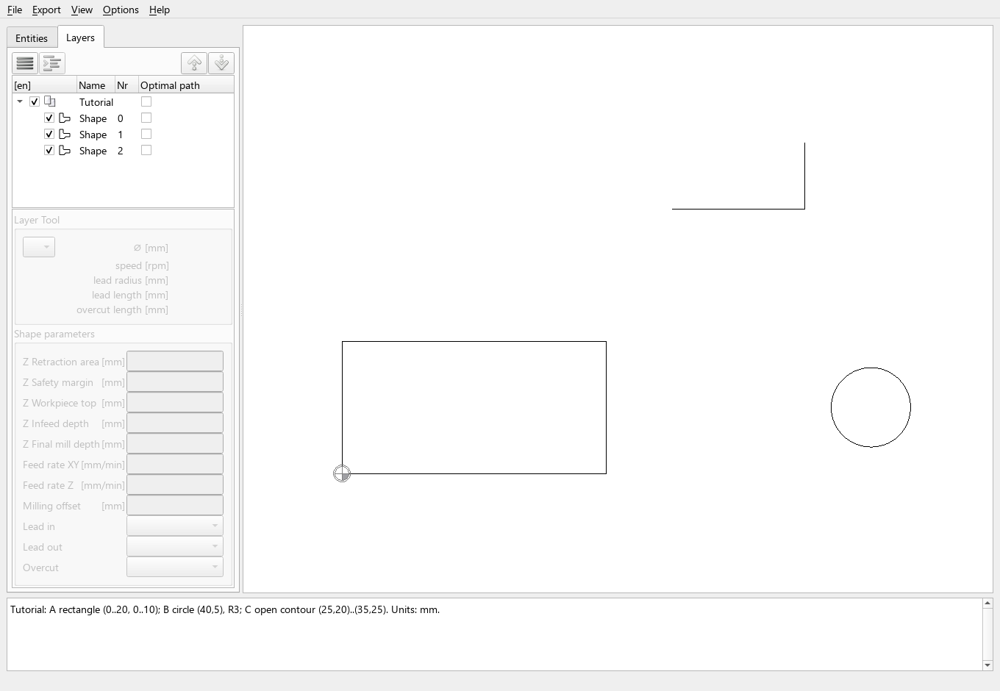

# Shapes, layers and tree order

Use the **Layers** tab to prepare the order of machining operations. The tree
contains layer rows, contour rows and, when added, custom G-code rows.
[Interface and navigation](interface-and-navigation.md) explains selection
and enable checkboxes.

## Example drawing

Download [three-shapes-mm.dxf](../assets/examples/machining-basics/three-shapes-mm.dxf).
This newly authored drawing contains three shapes in one `Tutorial` layer.
The letters below identify their geometry; they are documentation labels,
not text entities inside the DXF.

| Label | Geometry in millimetres | Initial import in the illustrated setup |
| --- | --- | --- |
| A | Closed rectangle, X = 0…20, Y = 0…10 | Shape 0 |
| B | Circle, centre (40, 5), radius 3 | Shape 1 |
| C | Open polyline, (25, 20) → (35, 20) → (35, 25) | Shape 2 |

Identify a contour by selecting it and checking the highlighted geometry.
Shape numbers identify imported contours; moving a row does not renumber it.
Import changes can produce different numbers or contour structures.

## Change the manual order

1. Open the example and expand `Tutorial` in **Layers**.
2. Select the row for C and use the upward move button above the tree to place
   it before A. Moving rows within the same layer is also supported by drag/drop.
3. Read the rows from top to bottom. The intended order is now C, A, B.
4. Choose **Export → Export Shapes without Optimization** to retain this order.

| Operation | Visible contour rows | Normal export sequence |
| --- | --- | --- |
| Initial example | A, B, C | A, B, C |
| Move C to the top | C, A, B | C, A, B |
| Disable A | C, A (disabled), B | C, B |

The **Optimal path** checkbox is separate from the enable checkbox. It does
not exclude a shape from a normal export. Do not use contour selection as an
export filter: enabled, unselected contours are included too.

Layer rows also have an order. Normal export processes enabled operations
layer by layer in tree order, not by an automatically inferred “inside first”
or nearest-neighbour rule. Changing layer order can change tool changes and
travel between operations. Cross-layer contour transfer is outside this
workflow; do not use it as a way to assign another tool.

## Start points and directions

For a selected contour, right-click in the drawing view and use
**Switch Direction** or **Set Nearest StartPoint**. Closed contours use eligible
segment starts; an open contour offers its endpoints. These choices affect
the approach and cutting direction without moving the contour's tree row.

Direction matters for [left/right cutter compensation](compensation-and-leads.md).
Check it again after reversing a contour. Changing a start point is different
from moving the workpiece origin or changing the drawing coordinates.

## Custom G-code rows

The tree context menu can insert configured custom G-code actions. An enabled
custom row is emitted at its position among the enabled rows during a normal
export; disabling it omits that action. Such a row has no contour geometry and
is not a point for the route optimizer.

Optimization can move contour rows relative to custom rows. A custom row's
position is therefore not a guaranteed barrier across optimization. See the
[mode comparison](route-optimization.md#constraints-and-custom-rows) before
combining custom actions with optimized export.

Save the preparation with **File → Save Project As...** to preserve ordering
and settings. [Projects](import-and-projects.md) explains matching limitations
when the source drawing changes.

Continue with [Route optimization](route-optimization.md) to distinguish a
manually ordered export, a route display and an optimized export.
