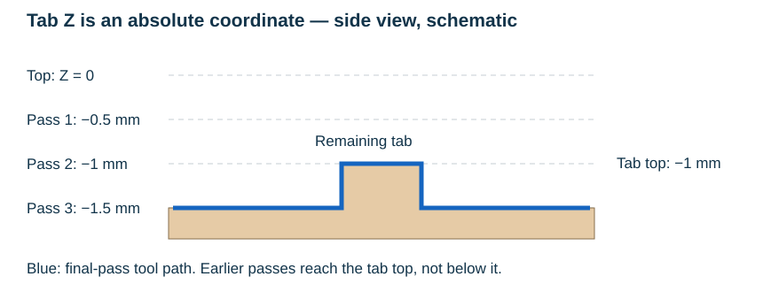

# Tabs and breaking layers

Tabs leave material across a contour so that a part can remain attached during
cutting. DXF2GCODE defines their locations with geometry on **BREAKS** layers.
This changes the planned Z movement through an intersection region; it is
different from disabling the entire contour for export.

## Draw the tab regions

Download [rectangle-with-tab-mm.dxf](../assets/examples/tabs/rectangle-with-tab-mm.dxf).
This own example contains a 20 × 10 mm rectangle on a milling layer and a small
closed rectangle crossing its bottom edge, X = 9…11 mm, on a BREAKS layer.
The example uses G40's nominal centre path; software offsets can change where
the cutting path intersects a break region.

The default separator is `:`. The example's layer names are:

```text
MILL: Tn:1 SMd:0 Sd:-0.5 Md:-1.5 FeedXY:200 FeedZ:100
BREAKS: Md:-1 FeedXY:200 FeedZ:100
```

The BREAKS contour is an instruction region, not another boundary to mill.
Keep the relevant break shape enabled. The splitter uses regions with two
intersections across a cutting segment; a tangency or ambiguous crossing is
not a reliable definition of a tab. Use a simple closed region extending
across the path and inspect the resulting preview.

See [Layer naming rules](layer-naming-rules.md) for the identifiers and their
case-sensitive prefixes. Renaming or filtering out the BREAKS layer changes
the preparation.

## Tab top is a Z coordinate

The break contour's **Z Final mill depth** sets the top Z of the tab. It is
not the tab's positive remaining thickness. In this example:

| Value | Millimetres |
| --- | --- |
| Workpiece top | `0` |
| Cutting infeed | `-0.5` |
| Final cutting depth | `-1.5` |
| Tab top, from the BREAKS shape | `-1` |

The final cut is 0.5 mm below the tab top. That difference describes the
material left above the final cut level, not a measured stock thickness.



## Choose when to process breaks

Select a cutting contour and use **Process breaks from** in the contour panel.
The control is available when applicable enabled BREAKS geometry exists.

| Choice | Behaviour |
| --- | --- |
| Last pass (default) | Apply break geometry on the final pass when its depth reaches the tab |
| 0 - never | Cut the unbroken contour on every pass |
| Pass 1, Pass 2, … | Apply break geometry from that pass onward |

Earlier passes use the unbroken contour. **A late start cannot restore
material already removed by an earlier pass.** Choose a start pass early
enough that previous cuts do not go below the intended tab top. In the example,
passes 1 and 2 reach -0.5 and -1 mm, so Last pass can retain the -1 mm tab top
during the -1.5 mm final pass.

The choice belongs to the cutting contour, not to the BREAKS region itself.
An explicit pass number that becomes too large after a depth edit is reset
to **Last pass**, with a message. Recheck it whenever depths change.

Save the preparation as a D2G project and inspect the Z movement in the output.
A flat 2D view cannot show the full lift/dip sequence. This example explains
the controls; tab strength and workholding still depend on the actual setup.

Continue with [Machine modes](machine-modes.md).
