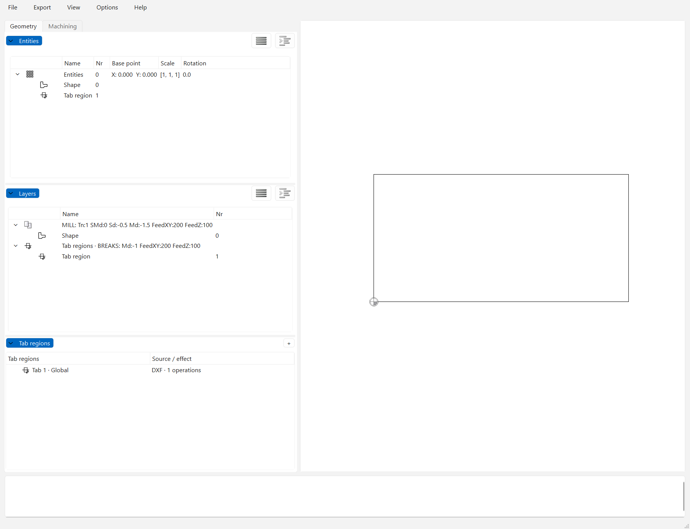
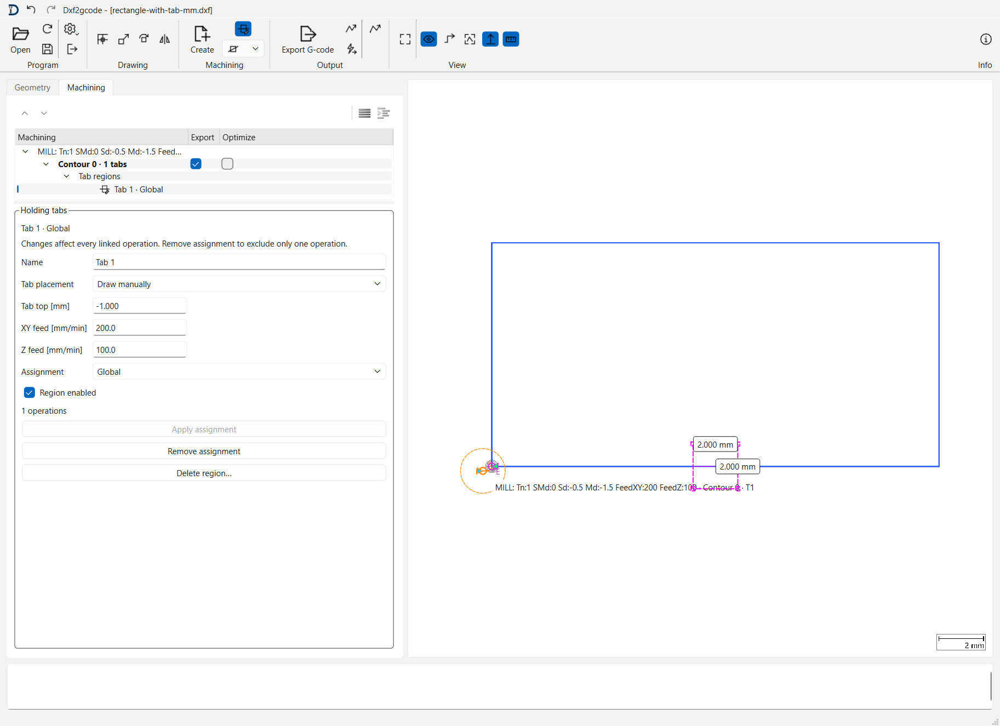
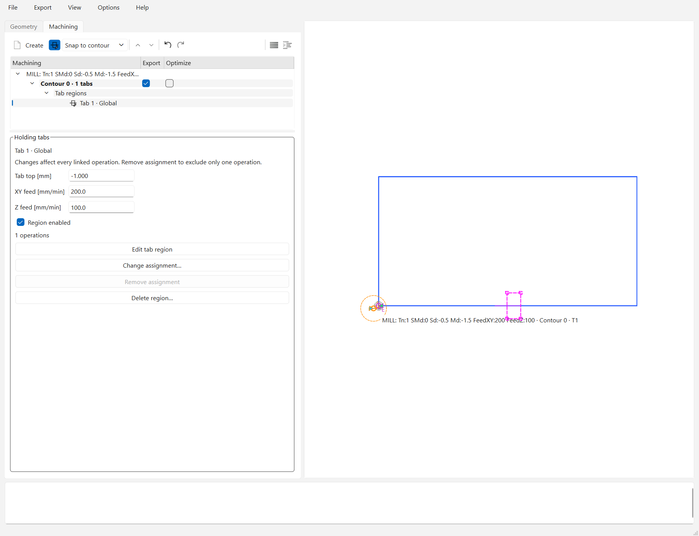
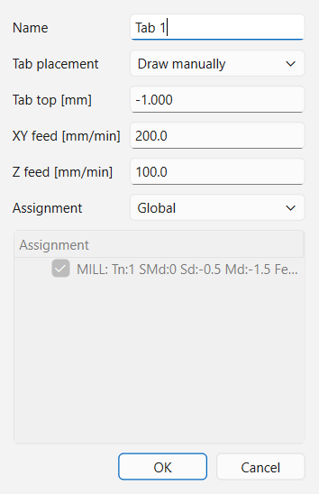
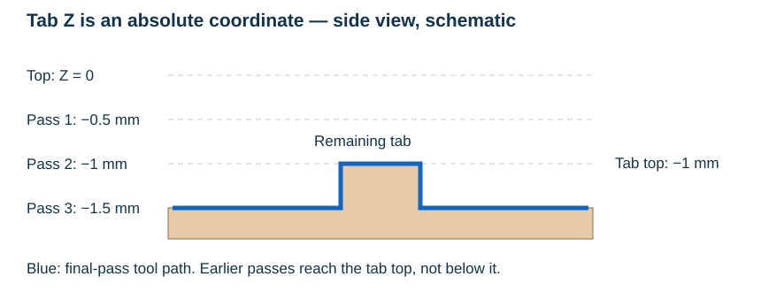

# Tabs and breaking layers

Holding tabs raise part of a cutting path to leave material connecting a part
to the stock. Their instruction regions are separate from contours to machine.
Import **BREAKS:** geometry or draw rectangular regions in the application.
Both are saved as project regions and use the same planning/export workflow.

## Find a region and its contour

In **Machining**, expand a contour's **Tab regions** group to see the regions
linked to it. The contour count reports linked regions; a single region can
produce several raised path segments. Repeated depth passes do not multiply
the count. Shared regions are references, not duplicate cutting contours.

The **Geometry** tab has a region catalogue, including disabled and ineffective
regions. Imported BREAKS shapes remain identifiable in Entities/Layers by their
region names/icons and are excluded from normal cutting-contour selection.
Selecting a BREAKS layer highlights its regions and all affected operations.



Selecting a machining contour displays its associated regions as thin dashed
magenta outlines. Selecting original geometry displays the union for its linked
operations. Selecting a region highlights its affected machining paths in blue;
red still denotes selected original geometry. These colours do not identify
different machining steps.

## Draw a new region

1. Select the target original contours, machining steps or operations.
   Original contours cover **all linked operations**; explicit machining
   selection covers only those operations. A step covers its operations.
2. Switch on **Tab edit mode** beside **Create** in the Machining toolbar.
   Drawing is available immediately. Choose **Snap to contour** or **Draw
   manually** beside the mode button for the next region.
3. Drag out a rectangle across the intended original contour. On release the
   region is created; no confirmation dialog interrupts successive drawing.
   Only eligible selected operations whose original contours pass through the
   region interior are assigned. Touching an edge/corner is insufficient.
4. Continue drawing, or select another target first. Clicking empty canvas
   clears the region and target selection. With no target, a drag can select
   geometry but cannot create a region in that same gesture.

New names are localized **Tab 1**, **Tab 2**, etc. Names remain freely editable.
The initial tab top comes from workpiece top, then the last confirmed height;
review it before use. Feeds come from the selected machining preparation.

### Automatic square size or manual rectangle

Under **Configuration → General settings → Tab regions**, the default is
**Snap to contour**, with remaining tab length `2` in configuration units.
The placement preset forms an aligned square with side length:

**tool diameter + configured remaining tab length**

Thus a 4 mm tool and 2 mm length produce a **6 × 6 mm** square. Drawing still
starts by dragging; release replaces the dragged size with the preset. This
is a size/alignment preset, not automatic distribution of tabs around a part.
Corners and tight curves can change the actual material left; inspect the path.

Each region stores its own automatic/manual mode. Changing a machining tool
resizes its automatic regions; a shared region is split by operation when
different tools require different sizes. The complete tool change is one undo
action. Manual regions retain their size. Configuration changes alone do not
resize existing regions. Imported regions initially use manual dimensions.

## Select, move, resize and edit

Click a region once to select it. The first press/drag only selects it.
Once selected, drag the region to move it or a corner handle to resize it.
Measurements appear at the upper and right edge midpoints **only while the
selection is at rest**, and disappear throughout a gesture.





Hover over a measurement and click to enter a positive size. **Enter** confirms,
**Escape** cancels. An entered size preserves the centre and other dimension,
creates one undo entry and switches the region to manual mode, even if the
typed value equals the previous size. Cancelling leaves its mode unchanged.

Hold **Ctrl** while drawing/moving/resizing to align to two intersections with
original geometry. The rectangle is centred between the contacts with one
axis along their connection. Its dimensions remain unchanged by this alignment.
If several original contours qualify, choose one on release; cancellation keeps
the unsnapped result. Missing/ambiguous contacts produce a message.

Double-click a region in the canvas or tree for its name, own placement mode,
tab-top Z, feeds and assignment. Drawing/editing uses 2D; starting from 3D opens
a separate 2D editing window. Regions follow whole-drawing transformations.



The parameter area provides activation, editing, **Change assignment…**,
**Remove assignment** and **Delete region…**. Removing one assignment preserves
other uses; deleting the region removes all its links after confirmation.
Original DXF geometry remains. Global scope covers eligible operations, step
scope also covers future eligible operations in that step, and selected-operation
scope follows stable operation identities. Local exclusions can be cleared
explicitly in the assignment editor. Undo/Redo restores the complete change.
Use the toolbar toggle to leave the mode; there is no special tab context menu.

## Imported example and Z height

Download [rectangle-with-tab-mm.dxf](../assets/examples/tabs/rectangle-with-tab-mm.dxf).
It contains a 20 × 10 mm contour and a small closed BREAKS rectangle crossing
its bottom edge at X = 9…11 mm. With the default `:` separator its layers are:

```text
MILL: Tn:1 SMd:0 Sd:-0.5 Md:-1.5 FeedXY:200 FeedZ:100
BREAKS: Md:-1 FeedXY:200 FeedZ:100
```

The BREAKS `Md` value initializes the **tab top Z**, not a positive thickness.
Here top is `0`, infeed `-0.5`, final depth `-1.5` and tab top `-1 mm`. The final
cut lies 0.5 mm below the tab top. This difference is not a measured stock thickness.



**Pass** in the Z values group controls when to process breaks for the machining
contour: **Last pass (default)** is the
default, **0 - never** disables processing, and a numbered pass starts it earlier.
A pass number invalidated by a depth change resets to Last pass with a message.
Earlier passes remain unbroken. **A late start cannot restore material already
removed.** In this example the first two passes reach -0.5 and -1 mm, so applying
the tab during the -1.5 mm final pass retains the -1 mm top.

## Original-contour reference and compensation

Use a closed polygon crossing the **original contour**. Boundaries are found
there for both software and machine compensation. Software compensation maps
them to the tool-centre path along line normals or arc radii; machine compensation
programs the original-contour locations. A region need not reach the software
offset path. No additional tangential cutter-radius allowance is applied.

A tab across a corner keeps the whole connecting offset curve raised. If a
boundary disappears or has several possible counterparts, the connected tab is
**omitted with a warning**, while other valid tabs remain and export continues.
Open/non-polygonal regions are also omitted with a warning. Review these messages.
Pocket boundaries use the same reference; internal raster passes retain spatial
region processing because they have no unique original-contour counterpart.
Drag-knife tab processing is unchanged.

Save regions and assignments as **D2G 2.1** and inspect exported Z movement.
2D overlays cannot show every lift/dip. Controller compensation and physical
workholding require their own checks. Continue with [Machine modes](machine-modes.md).
