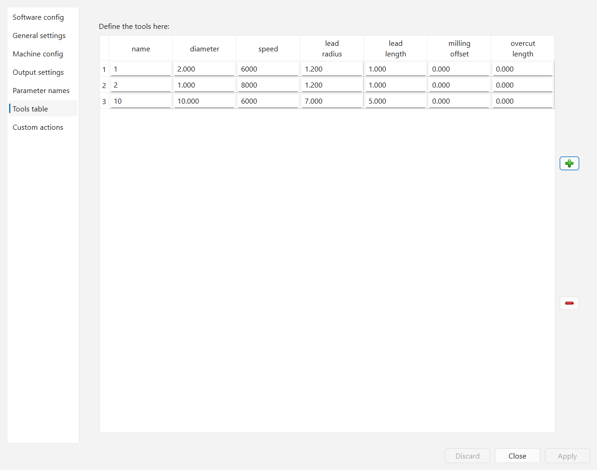

# Maintain the tool table

Open **Options → Configuration → Tools table** in the active application profile.
The numeric identifier is the output **tool number**, not a free-text tool name.
Check configuration units before entering dimensions. For milling the diameter
is the cutter diameter; drag-knife dimensions have their machine-specific meaning.

The table provides tool definitions and starting values for a new DXF. Imported
layer identifiers can also initialize machining settings. Review the effective
tool and contour values after import; see [DXF layer rules](../layer-naming-rules.md).

Applying table changes does not silently replace saved tool definitions in an
already prepared project. Use [project-tool resolution](project-tools.md) for
that explicit action. Identical complete definitions appear once in the selector.

Lead dimensions and overcut become machining values: change their effective
step/operation values in the [Machining form](../machining-parameters.md), with
inheritance shown by the provenance symbols. Number-display rounding does not
reduce stored or entered precision.

Continue with [Assign and change tools](assignments.md).
